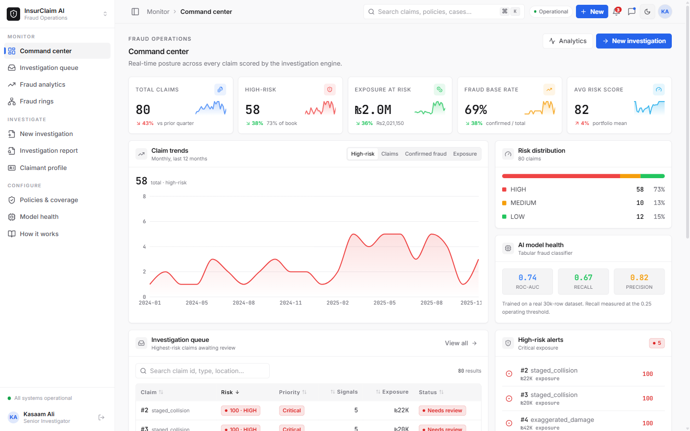
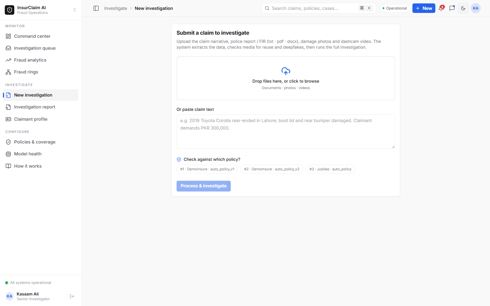

<div align="center">

# 🔎 InsurClaim AI

### Multi-agent AI platform for investigating auto-insurance claims

Takes a claim (documents, photos, videos) and produces a **ranked, explainable investigator report**:
risk score, event timeline, flagged inconsistencies, a **live-priced fair-cost check**, source citations,
and a recommended action.
**Human-in-the-loop by design: it flags and ranks, it never auto-denies.**

<br/>

[](https://www.youtube.com/watch?v=P9qCfmYFBWI)

<br/>


<br/>


-blue?style=flat-square)


</div>

---

## 🎥 Demo

A short end-to-end walkthrough: submit a claim, watch the agents investigate, and read the ranked
report with the live-priced fair-cost check.

[](https://www.youtube.com/watch?v=P9qCfmYFBWI)

> ▶️ **[Watch the full demo on YouTube](https://www.youtube.com/watch?v=P9qCfmYFBWI)**

---

## 📋 Overview

InsurClaim AI is a multi-agent system that investigates an auto-insurance claim the way a senior
investigator would, then hands a human adjuster a ranked, cited report to act on. A claim goes in as raw
evidence; a structured decision-support report comes out in seconds.

| | |
|---|---|
| **What it is** | A multi-agent AI platform that investigates auto-insurance claims end to end. |
| **Input** | One claimant's claim file: documents, damage photos, and video. |
| **Output** | A ranked, cited investigator report: risk score, event timeline, flagged inconsistencies, a live-priced fair-cost check, and a recommended action. |
| **Who it is for** | Claims adjusters and special-investigation units. It is human-in-the-loop and never auto-denies. |
| **Market focus** | Built for the Pakistani motor market first (pricing in PKR); the approach generalizes to any motor-insurance market. |
| **How it works** | Four LangGraph agents (`intake -> timeline -> fraud -> report`) plus a dedicated fair-cost assessor, behind an async Starlette API with a React dashboard. |

---

## 🎯 The problem

Insurers lose an estimated **10% of every claim dollar to fraud and inflated payouts**, while human
investigators can only read a handful of files a day. The hard cases are not obvious lies; they are
subtle inconsistencies buried across a police report, a repair invoice, a medical note, and a set of
damage photos. Reading all of that for every claim, and knowing whether the amount being demanded is
even fair, does not scale.

**InsurClaim AI reads the entire claim file the way a senior investigator would**, in seconds, and
hands the adjuster a ranked, cited report they can act on. It never denies a claim on its own; it makes
the human faster and better informed.

---

## 📸 A look at the product

**Command center**: real-time posture across every scored claim, with KPIs, claim trends, the live
risk distribution, model health, and the highest-risk queue.



**New investigation**: drop in a claimant's documents, photos, and dashcam video (or paste the claim
text), pick the policy to check against, and run the full investigation.



---

## ✨ Highlights

- 🧠 **Four specialized agents** orchestrated with a **LangGraph** state machine (`intake -> timeline -> fraud -> report`), plus a dedicated cost-assessment step.
- 💰 **Live-priced fair-cost check** a quantum-analysis agent searches the **live web** for current market prices of the damaged parts (PakWheels, OLX Pakistan, local workshops, parts dealers), builds a fair repair-cost estimate in **PKR**, and judges whether the demanded amount is reasonable or inflated, with a source next to every line item. **This is a headline feature, detailed below.**
- 🕵️ **Document-level fraud detection** reads the *whole* claim file and surfaces concrete inconsistencies (location/GPS mismatch, timeline gaps, physically-impossible damage, airbags-but-no-medical, repeat claims, inflated cost).
- 🧾 **Explainable reason codes** every risk score breaks down into weighted signals with an evidence pointer; nothing is a black box.
- 📎 **Multi-format intake** TXT, PDF, **DOCX**, images, and **video** (frame sampling). Scanned or image-only PDFs are read with a **vision-OCR fallback**.
- 🧪 **AI-generated (deepfake) media detection** metadata/EXIF/C2PA forensics plus a vision-model artifact check flag synthetic damage photos and videos.
- 🛡️ **Policy-driven coverage gate** pick which policy a claim falls under; the system checks coverage **and** whether every document that policy requires is present before fraud runs.
- 🕸️ **Fraud-ring detection** connected components over the RAG similarity graph reveal organized rings.
- 💬 **AI chat + case management** ask grounded follow-up questions per claim, set status and assignee, and keep an audit trail of notes.
- 🔁 **Resilient LLM layer** a multi-provider fallback chain with key rotation; the pipeline degrades gracefully instead of crashing when a provider quota is exhausted.

---

## 🏗️ Architecture: 4 agents, one shared state

A shared `ClaimState` flows through a LangGraph graph: **`intake -> timeline -> fraud -> report`**.

| # | Agent | What it does |
|---|-------|--------------|
| 1 | **Intake & Extraction** | Documents, photos, and videos into structured claim JSON (degrades to raw text if the LLM is unavailable). |
| 2 | **Timeline / Causal Reasoning** | Orders events A, B, C; flags inconsistencies and gaps; runs a light deterministic physics-sanity check. |
| 3 | **Fraud & Anomaly** | Hybrid of 6 layers: deterministic rules, duplicate-photo hashing, fine-tuned ML score, similar-past-claim RAG, **full-document narrative red-flag analysis**, and LLM synthesis. |
| 4 | **Adjudication / Report** | Synthesizes a ranked, cited report with confidence scores and a recommended action (`route_to_investigator`, `request_more_info`, `fast_track_approve`). |

Alongside the graph, the pipeline runs a dedicated **Amount / Quantum assessor** (below) so the final
report answers not just *"is this fraud?"* but also *"is the money being asked for fair?"*. The whole
pipeline runs behind an async **Starlette** API. Two front ends consume it: a modern **React**
investigator dashboard (primary) and a classic **Streamlit** dashboard (still included).

---

## 💰 Fair-cost assessment with live market prices

Most fraud tools only answer *is this claim fake?*. A huge share of real leakage is **honest claims
with inflated numbers**, so InsurClaim AI also answers *is the amount fair?*.

The **Amount / Quantum assessor** (`insurclaim/amount.py`) works like a claims cost analyst:

1. **Reads the claim** to identify the vehicle (make, model, year) and every damaged part or required repair.
2. **Searches the live web** for the current market price of each part and the typical labour rate, grounded in real listings from **PakWheels, OLX Pakistan, local workshops, and parts dealers** (via a Google-Search-grounded model).
3. **Builds a fair-cost estimate in PKR** as a low-to-high range, with a **line-item breakdown** where every item carries the **source it was priced from**. Prices found in another currency are converted to PKR.
4. **Respects the policy** sum-insured limit, sub-limits, and deductible when a policy is attached.
5. **Delivers a verdict** on the demanded amount: `reasonable`, `overstated`, `understated`, or `insufficient_info`, with a short rationale.

If live search or the model is unavailable, it falls back to a knowledge-only estimate and clearly
marks the result as a model estimate rather than a market-grounded one, so the adjuster always knows
how much to trust the number.

> Example: on a demo claim demanding roughly **PKR 850,000**, the assessor priced the described damage
> at a fair **~PKR 85,000** using live part prices and flagged the demand as **overstated**, with the
> source next to each priced line.

---

## 🕵️ How fraud is detected: 6 hybrid layers

The Fraud & Anomaly agent does not rely on a single model. It combines six independent signals, and
**every flag it raises is explainable** (a finding, its evidence, and a suggested action):

| Layer | Signal |
|-------|--------|
| **Deterministic rules** | Hard checks: policy active on the incident date, amount vs sum-insured, reporting delay, missing FIR, repeat claimant or repeat VIN velocity. |
| **Duplicate-photo hashing** | Perceptual hashes catch damage photos reused across claims. |
| **Fine-tuned ML score** | A DistilBERT narrative classifier and a tabular Random Forest trained on real data. |
| **Similar-past-claim RAG** | Chroma vector search surfaces near-duplicate prior claims and organized rings. |
| **Narrative red-flag analysis** | An LLM reads the full document set for internal contradictions and impossible details. |
| **LLM synthesis** | A final reasoning pass weighs every signal into a single explainable risk score. |

---

## 🧰 Tech stack

| Layer | Technology |
|-------|-----------|
| **Orchestration** | LangGraph, LangChain-core |
| **LLMs** | Multi-provider wrapper with fallback + key rotation: **Z.AI (GLM), OpenRouter, Gemini, Claude, Groq**; Gemini/OpenRouter for vision; Gemini Google-Search grounding for live pricing |
| **API** | Starlette (async), served with Uvicorn |
| **Web dashboard** | **React + Vite**, Tailwind CSS, Recharts, Framer Motion, lucide-react |
| **Classic dashboard** | Streamlit with custom CSS (also included) |
| **Vector DB / RAG** | Chroma (Pinecone-ready abstraction) |
| **Relational store** | PostgreSQL (claims, parties, vehicles, photo hashes, policies, cases) |
| **Fine-tuning / ML** | DistilBERT (narrative), class-balanced Random Forest (tabular, real 30k rows) |
| **Media** | pypdf, pdfplumber, pypdfium2 (vision-OCR), python-docx, OpenCV, Pillow, imagehash |
| **Infra** | Docker Compose; AWS deployment plan (RDS, S3, ECS/EC2, optional SageMaker / Bedrock) |

---

## 📊 Data

- **Synthetic claims** an LLM generator produces realistic narratives with injected fraud patterns and ground-truth labels (used by the LLM agents and narrative fine-tuning).
- **Real dataset** a public **30,000-row** car-insurance fraud dataset, downloaded on demand and loaded into PostgreSQL to train and evaluate the tabular classifier
  (**ROC-AUC around 0.74**, roughly **67%** fraud recall at a recall-favoring threshold).

> No real personal data is used. The real dataset is a public, anonymized research dataset.

---

## 🚀 Quick start

### Option A: one command (Windows)

```bat
start-all.bat
```

This boots Docker, the PostgreSQL database, the Starlette API, the React dashboard, the Streamlit
dashboard, and the React landing page, then opens the landing page in your browser. Each service runs
in its own window; the terminals print the local address to open.

### Option B: manual

```bash
# 1. Start PostgreSQL (Docker Desktop must be running)
docker compose -f infra/docker-compose.yml up -d db

# 2. Load the real dataset and train the fraud classifier
python -m insurclaim.data.load_real
python -m insurclaim.ml.train_tabular

# 3. Run the full pipeline on one claim from the CLI
python -m insurclaim.main --claim 1

# 4. Start the API and the web front ends (each prints its local URL)
python -m uvicorn api.main:app --port 8000     # API backend
cd dashboard && npm install && npm run dev      # React investigator dashboard
cd landing   && npm install && npm run dev      # React landing page

# (optional) the classic Streamlit dashboard
streamlit run frontend/app.py --server.port 8501
```

Configuration (API keys, database, model names) lives in **`.env`**: copy `.env.example` and fill in
your own values. See **[`DEMO.md`](./DEMO.md)** for a full end-to-end walkthrough and
**[`COMPETITORS.md`](./COMPETITORS.md)** for market positioning.

---

## 📖 Guide: using the app

Once the stack is running, a typical investigation looks like this:

1. **Open the landing page** and sign in with the demo credentials from `.env.example` (change them before any real deployment).
2. **Start a new investigation:** upload one claimant's documents, damage photos, and video, and pick which policy the claim falls under.
3. **Watch the agents work** in the live timeline as intake, timeline, fraud, and the fair-cost assessor run in turn.
4. **Read the report:** the risk score and its band, each flagged inconsistency with its evidence, the fair-cost estimate against the demanded amount, and the recommended action.
5. **Ask follow-ups and decide:** use the built-in chat to question the case, set status and assignee, and make the final call. The system never denies a claim on its own.

For a full command-by-command walkthrough with expected outputs, see **[`DEMO.md`](./DEMO.md)**.

---

## 🗂️ Project layout

```
insurclaim/     Core Python package: agents, LangGraph pipeline, amount assessor, LLM wrapper, ML, DB, RAG
api/            Starlette async API that runs the pipeline and serves the dashboard
dashboard/      React + Vite investigator dashboard (primary UI)
landing/        React + Vite landing page
frontend/       Classic Streamlit dashboard
infra/          Docker Compose + AWS deployment plan
docs/           Business case and research notes
```

---

<div align="center">

**Built as a portfolio project** · synthetic & public data only · human-in-the-loop, never auto-deny.

</div>
